# BLOCK 1 — галерея диагностики

## 01-rest-b13-vs-block1.png
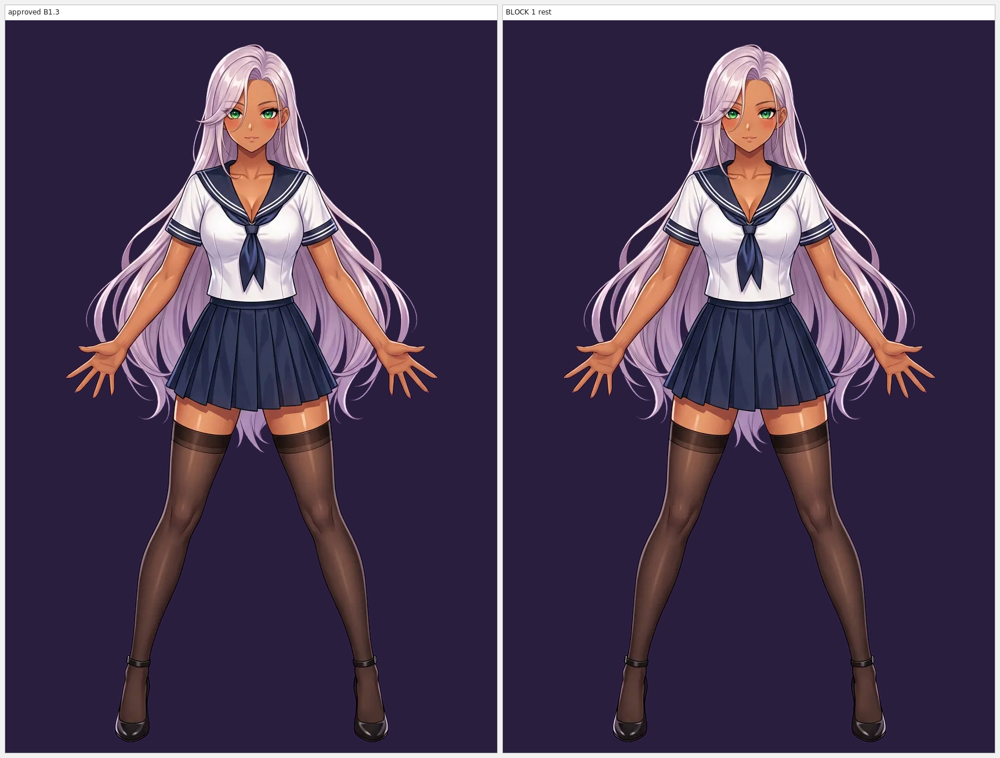
[Открыть](01-rest-b13-vs-block1.png)

## 02-underlay-union-zones.png
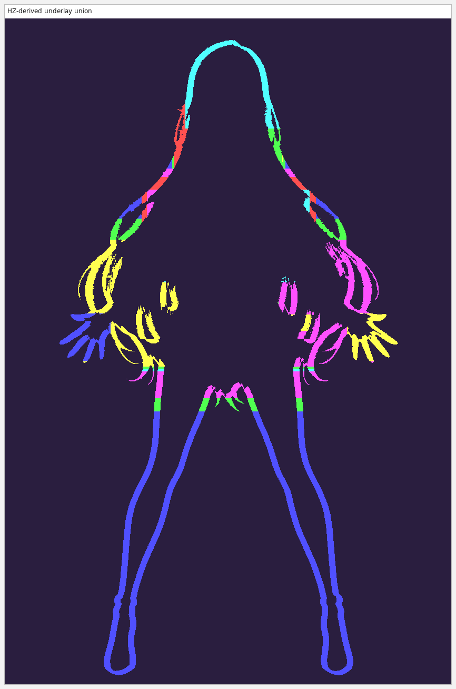
[Открыть](02-underlay-union-zones.png)

## 03-gaps-before-after.png
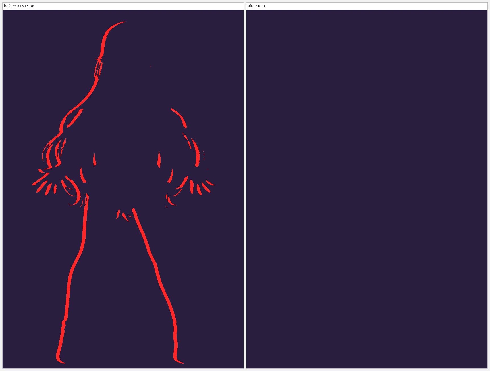
[Открыть](03-gaps-before-after.png)

## 04-nine-phases.png
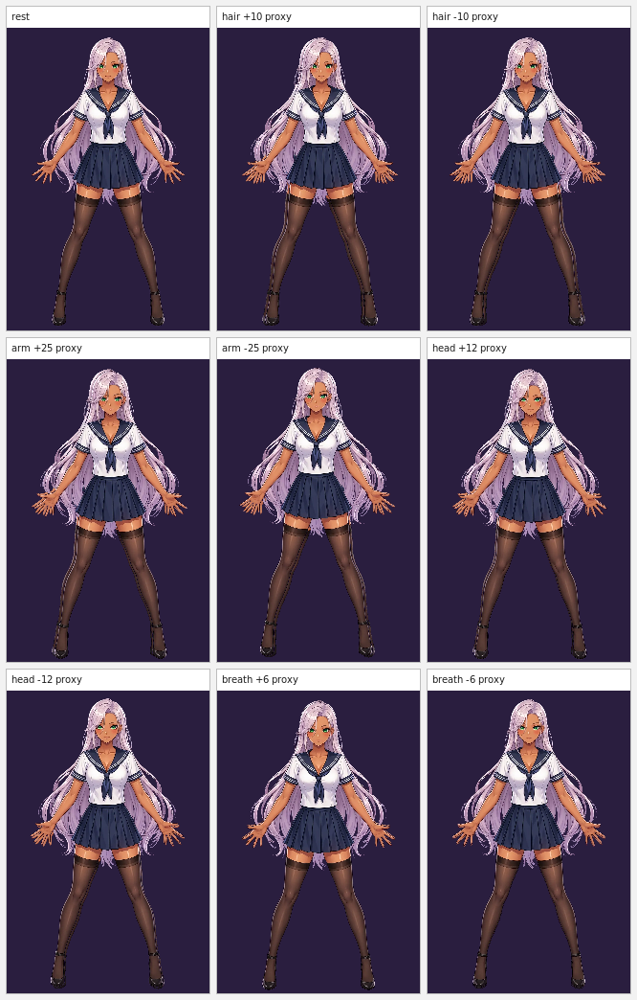
[Открыть](04-nine-phases.png)

## 05-closeup-head-collar-shoulders.png
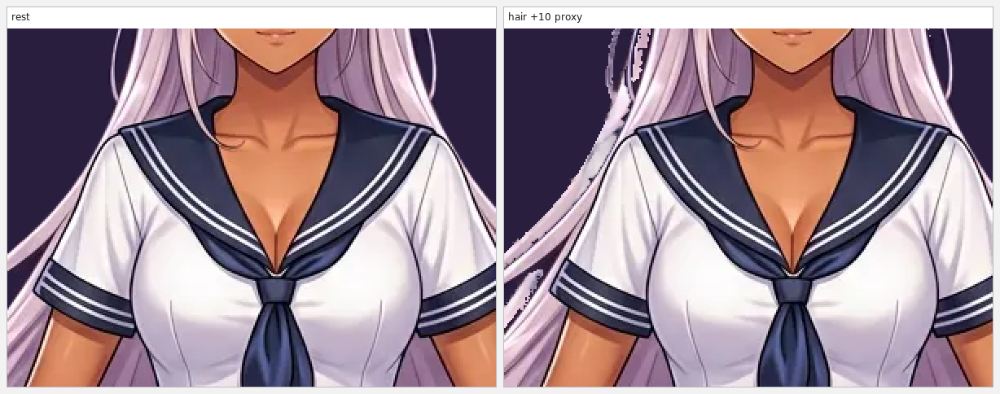
[Открыть](05-closeup-head-collar-shoulders.png)

## 06-closeup-arms-hair.png
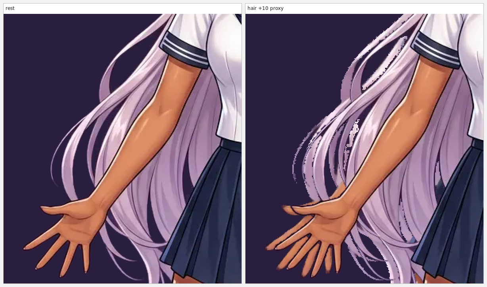
[Открыть](06-closeup-arms-hair.png)

## 07-closeup-skirt-hem.png
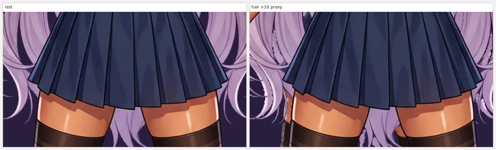
[Открыть](07-closeup-skirt-hem.png)

## 08-20-slots-contact.png
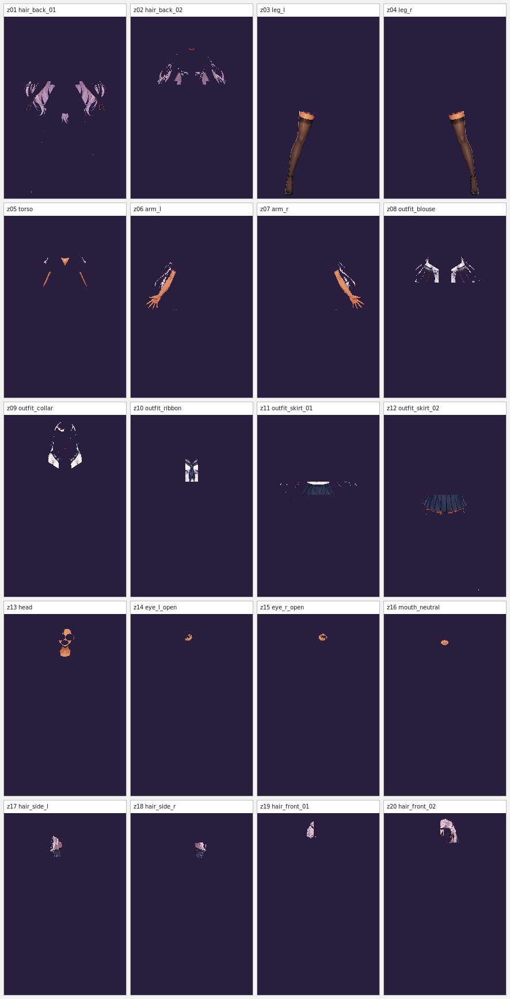
[Открыть](08-20-slots-contact.png)

## 09-24-states-contact.png
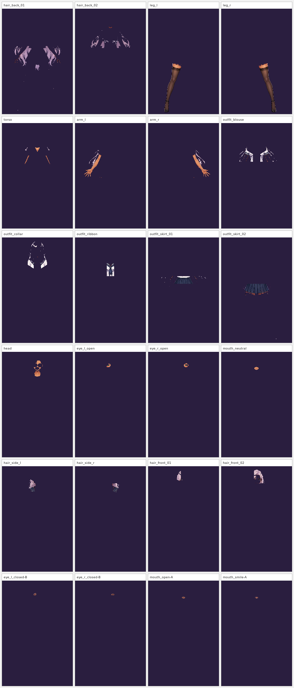
[Открыть](09-24-states-contact.png)

## 10-10-full-frame-states.png
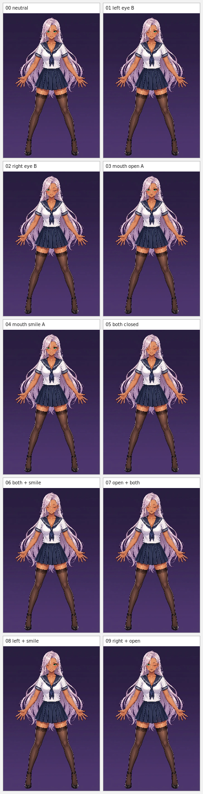
[Открыть](10-10-full-frame-states.png)

## 11-expression-check-4x.png
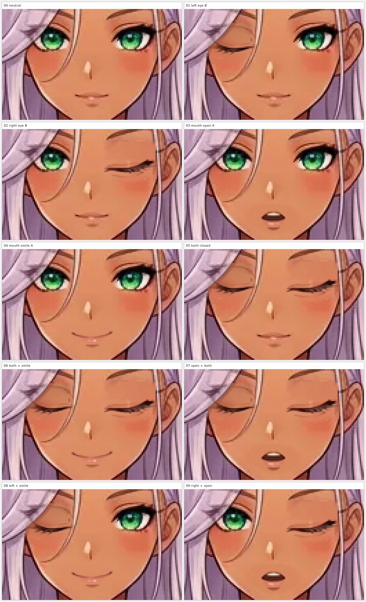
[Открыть](11-expression-check-4x.png)

## 12-26-HZ-masks.png
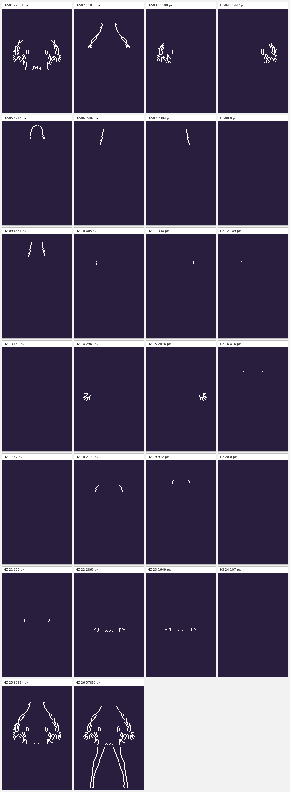
[Открыть](12-26-HZ-masks.png)

## 13-x4-closeups.png
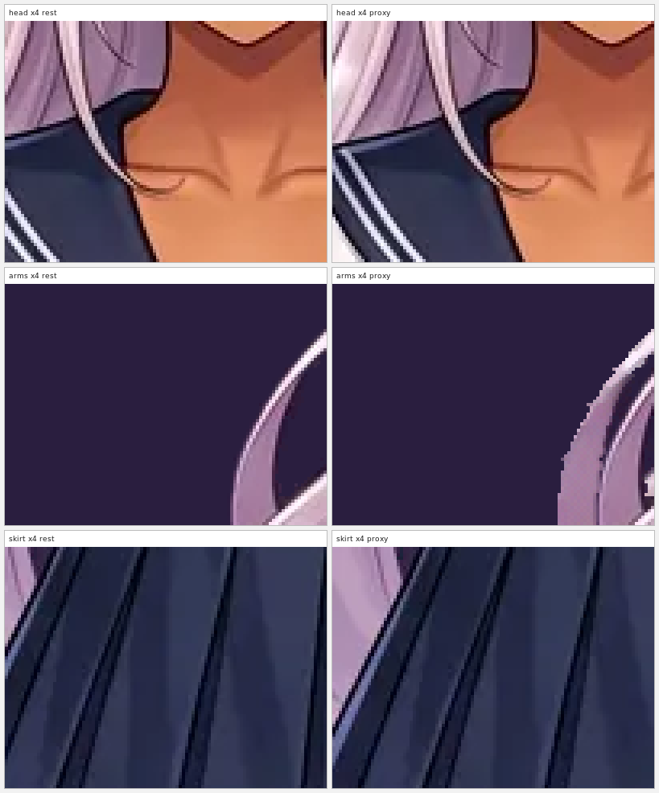
[Открыть](13-x4-closeups.png)

## 14-x8-closeups.png
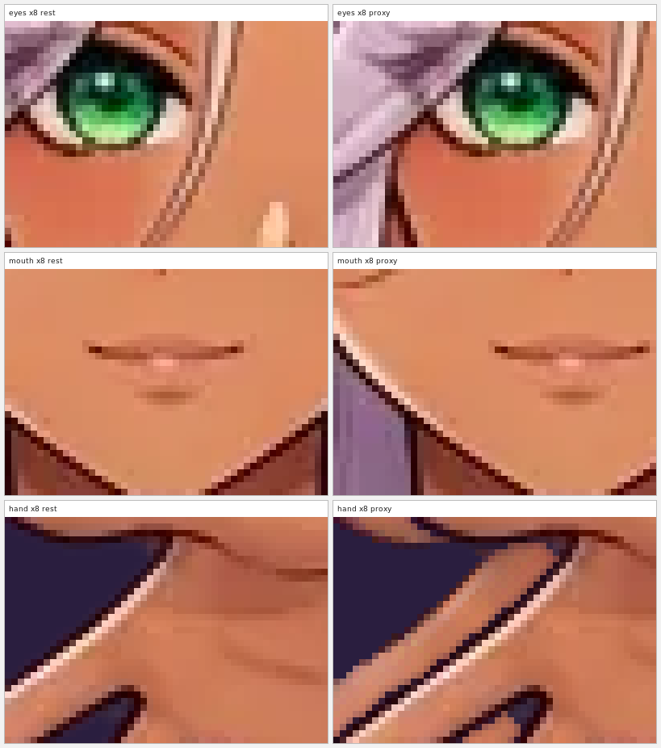
[Открыть](14-x8-closeups.png)

## 15-underlay-gating.png
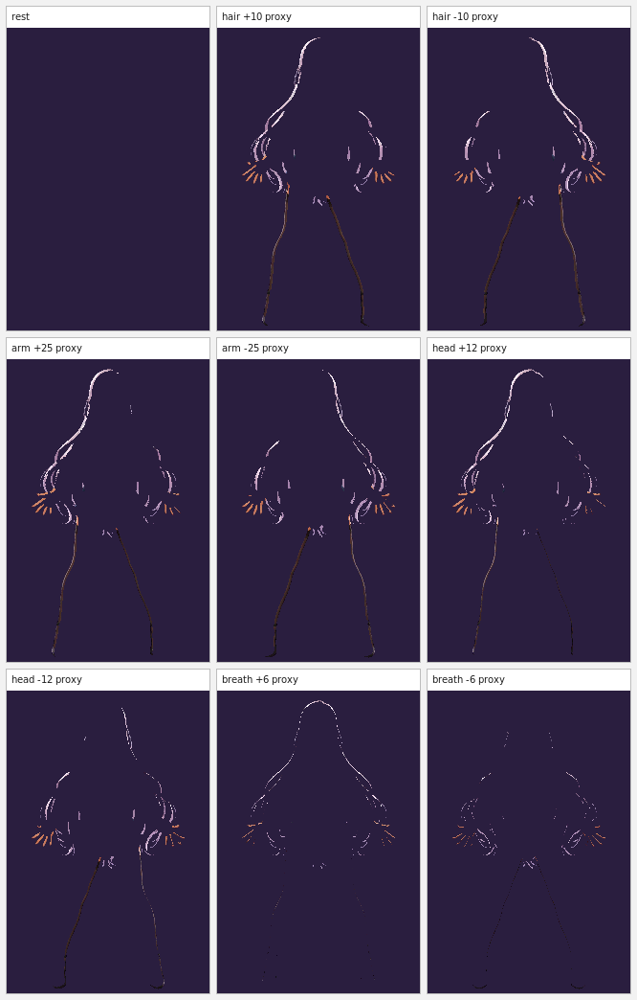
[Открыть](15-underlay-gating.png)

## gaps-after.png

[Открыть](gaps-after.png)

## gaps-before.png
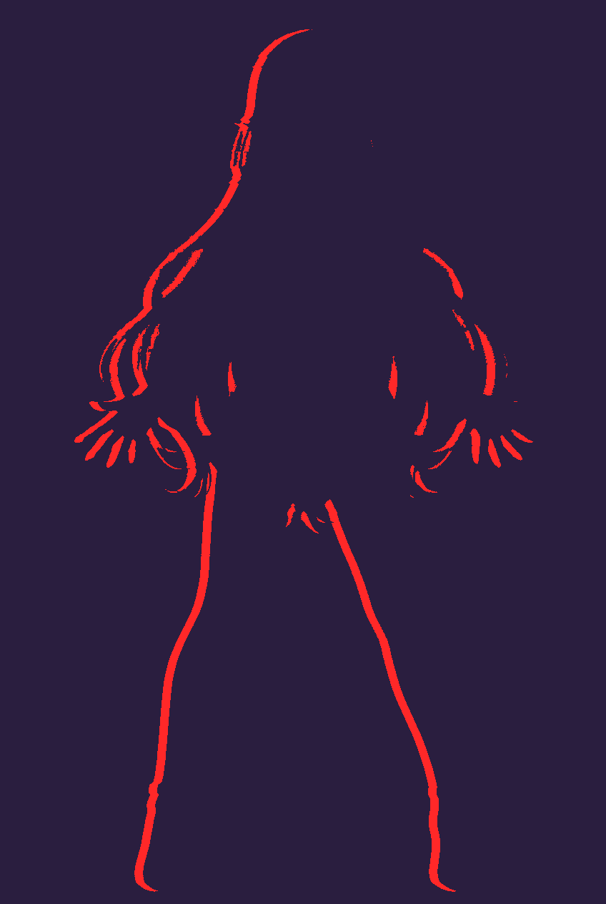
[Открыть](gaps-before.png)

## phase-arm_reaction_+25deg_proxy.png

[Открыть](phase-arm_reaction_+25deg_proxy.png)

## phase-arm_reaction_-25deg_proxy.png

[Открыть](phase-arm_reaction_-25deg_proxy.png)

## phase-breath_+6deg_proxy.png

[Открыть](phase-breath_+6deg_proxy.png)

## phase-breath_-6deg_proxy.png

[Открыть](phase-breath_-6deg_proxy.png)

## phase-hair_sway_+10deg_proxy.png

[Открыть](phase-hair_sway_+10deg_proxy.png)

## phase-hair_sway_-10deg_proxy.png

[Открыть](phase-hair_sway_-10deg_proxy.png)

## phase-head_tilt_+12deg_proxy.png

[Открыть](phase-head_tilt_+12deg_proxy.png)

## phase-head_tilt_-12deg_proxy.png

[Открыть](phase-head_tilt_-12deg_proxy.png)

## phase-rest.png

[Открыть](phase-rest.png)

## rest-b13-over-solid.png

[Открыть](rest-b13-over-solid.png)

## rest-block1-over-solid.png

[Открыть](rest-block1-over-solid.png)

## solid-background.png

[Открыть](solid-background.png)

## Документы

- [Отчёт BLOCK 1](../BLOCK-1-REPORT.md)
- [VERIFICATION.json](../VERIFICATION.json)
- [CHANGED-PIXELS.json](../CHANGED-PIXELS.json)
- [ASSEMBLY-MANIFEST.json](../ASSEMBLY-MANIFEST.json)
- [26 HZ-масок](../underlays/HZ-MASKS.json)
- [UNDERLAY-GATING.json](../underlays/UNDERLAY-GATING.json)
