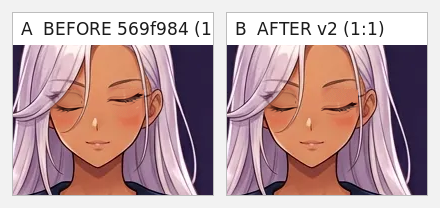
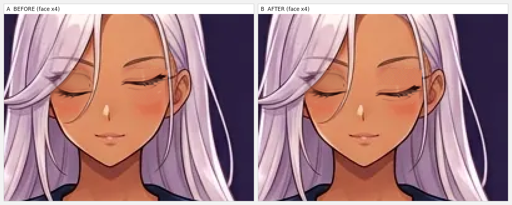
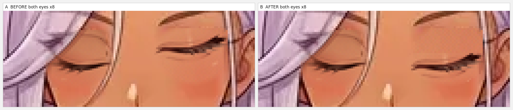
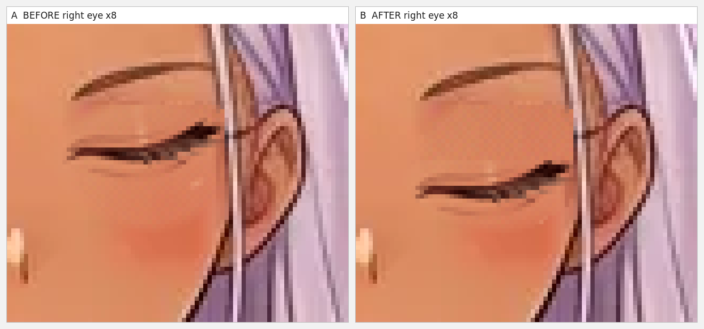
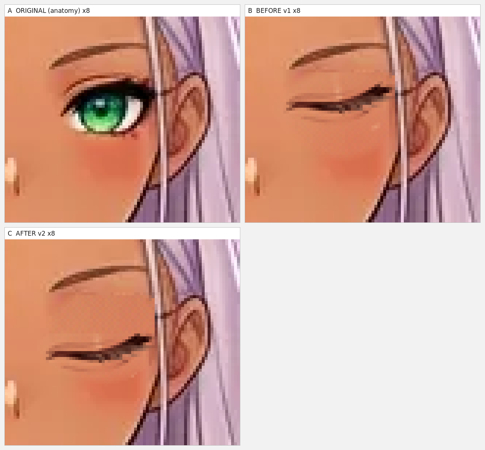
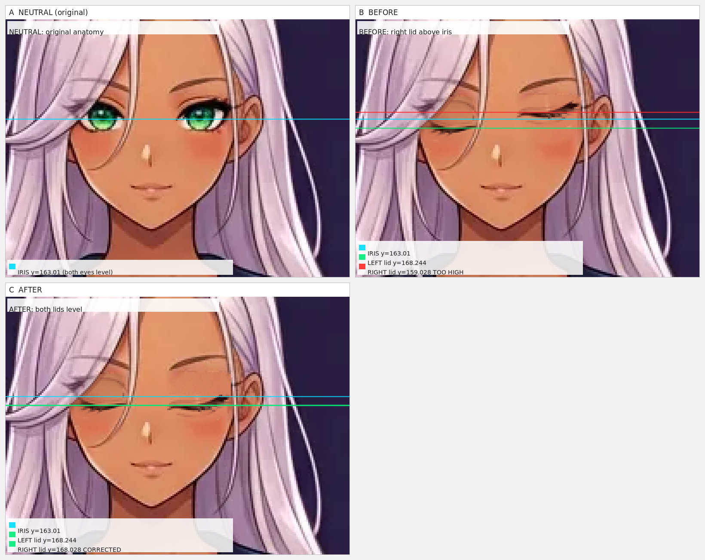
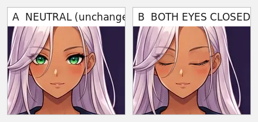
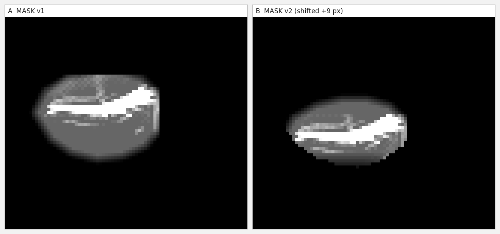

# E2 — коррекция положения глаз V2: галерея

Версия-родитель `569f984…` не изменена. Сначала узкие листы для iPhone, затем полные.

## ДО / ПОСЛЕ, 1:1

[Открыть полный лист](comparison/01-before-after-1x.png)

## Лицо ×4

[Открыть полный лист](comparison/02-before-after-4x.png)

## Оба глаза ×8

[Открыть полный лист](comparison/03-both-eyes-closeup-8x.png)

## Правый глаз ×8

[Открыть полный лист](comparison/04-right-eye-closeup-8x.png)

## Оригинал / ДО / ПОСЛЕ

[Открыть полный лист](comparison/05-original-before-after-right-8x.png)

## Схема уровней

[Открыть полный лист](comparison/06-eye-level-diagram.png)

## Нейтраль / оба закрытых

[Открыть полный лист](comparison/07-neutral-vs-both-closed-1x.png)

## Маска ДО / ПОСЛЕ

[Открыть полный лист](comparison/08-mask-before-after-8x.png)

## Узкие листы для iPhone

- [1:1 ДО/ПОСЛЕ](comparison/mobile/01-before-after-1x.png)
- [Лицо ×4 (столбец)](comparison/mobile/02-before-after-4x-stacked.png)
- [Оба глаза ×8 (столбец)](comparison/mobile/03-both-eyes-closeup-8x-stacked.png)
- [Правый глаз ×8 (столбец)](comparison/mobile/04-right-eye-closeup-8x-stacked.png)
- [Оригинал/ДО/ПОСЛЕ ×6 (столбец)](comparison/mobile/05-original-before-after-right-6x-stacked.png)
- [Схема ×3 (столбец)](comparison/mobile/06-eye-level-diagram-3x-stacked.png)
- [Нейтраль/оба закрытых 1:1](comparison/mobile/07-neutral-vs-both-closed-1x.png)
- [Маска ×6 (столбец)](comparison/mobile/08-mask-before-after-6x-stacked.png)

## Документы

- [Полный отчёт](E2-EYE-ALIGNMENT-V2-REPORT.md)
- [Измерения](00-measurements.json)
- [Проверки](verify-report.json)
- [Матрица переключения](states/switch-matrix.json)
- [Метаданные](E2-eye-alignment-v2.json)
- [SHA256-манифест](SHA256-MANIFEST.txt)

