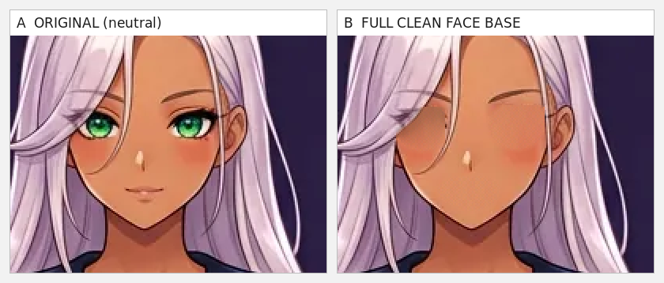
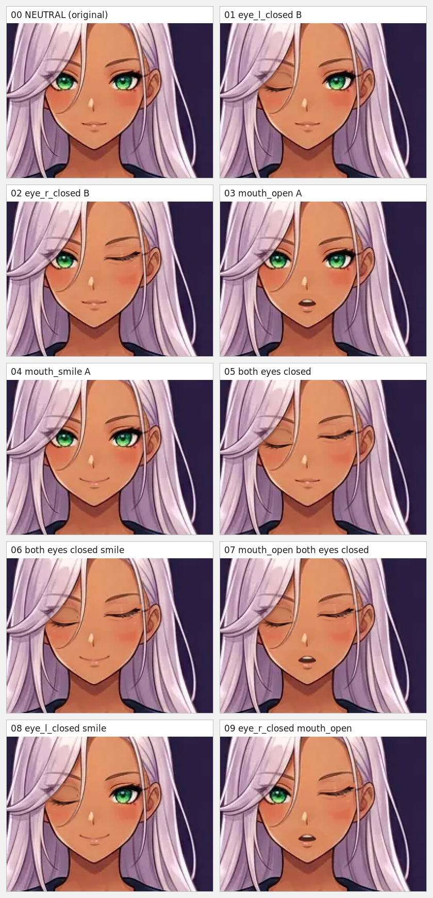
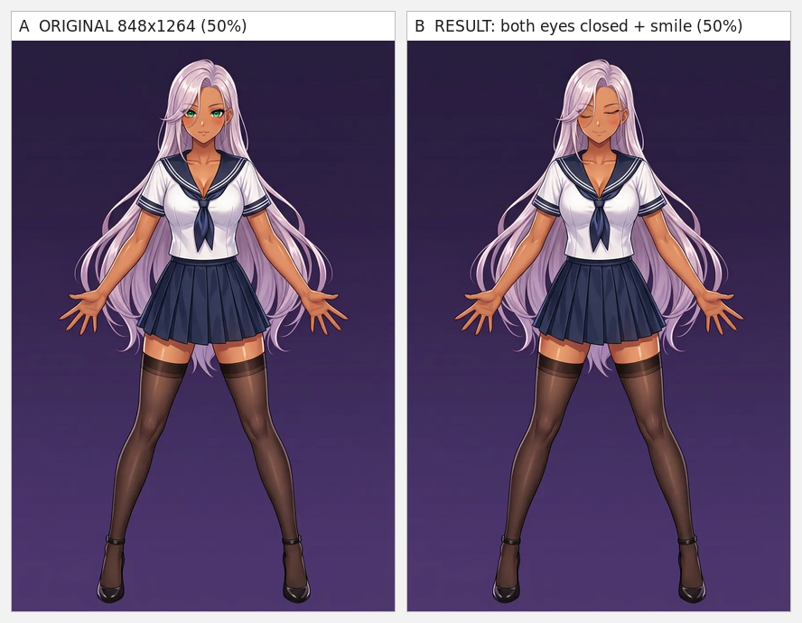
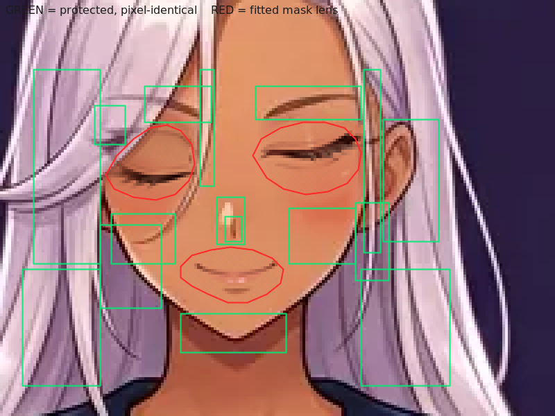
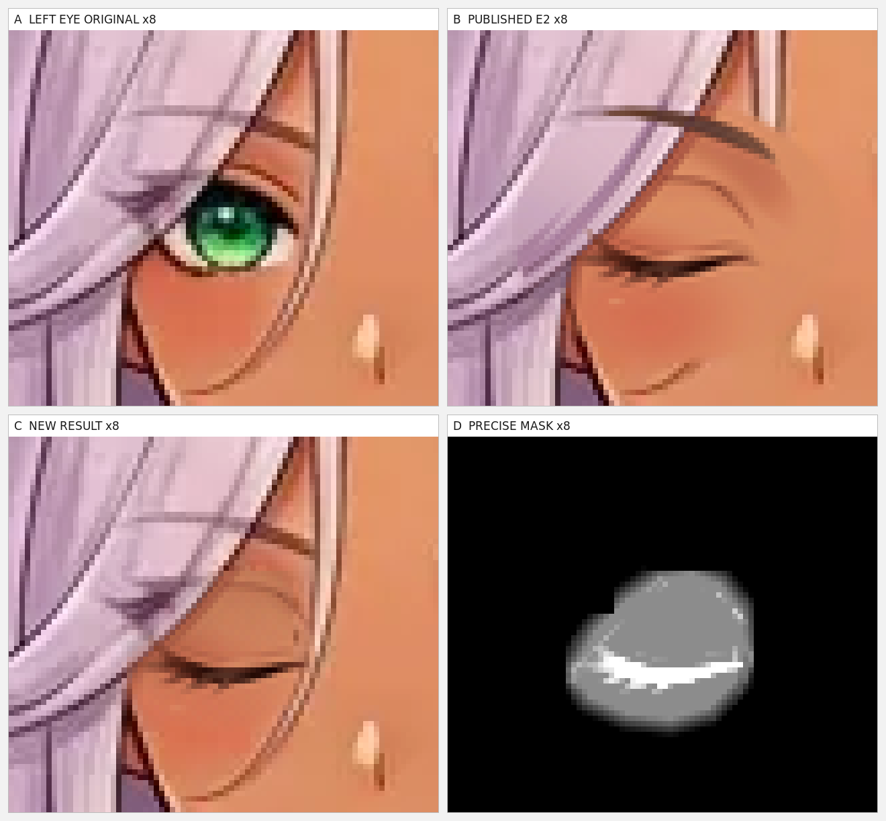
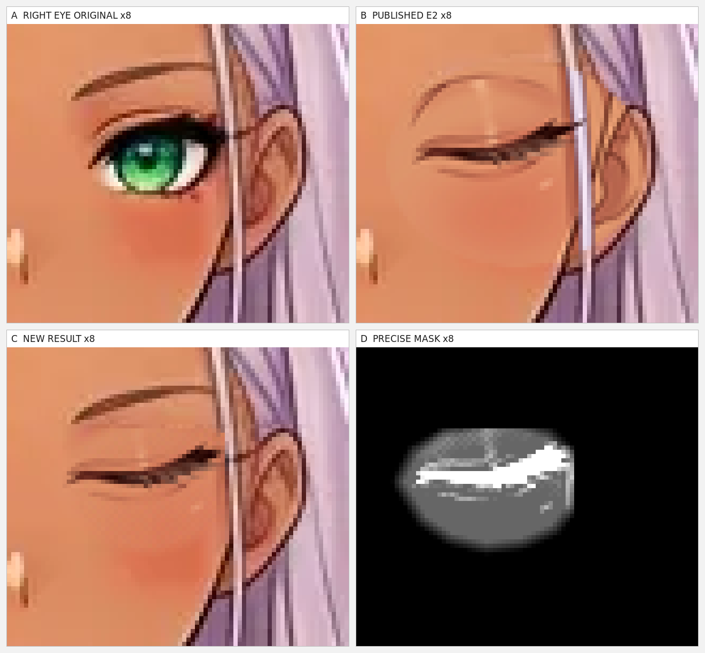
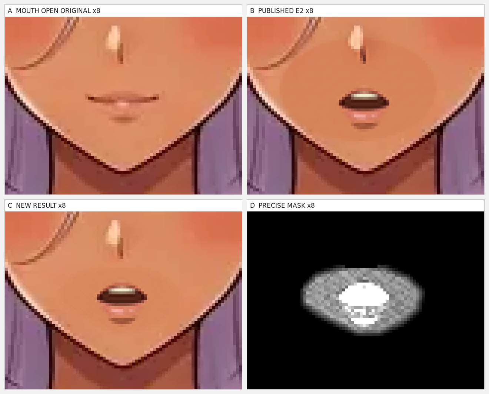
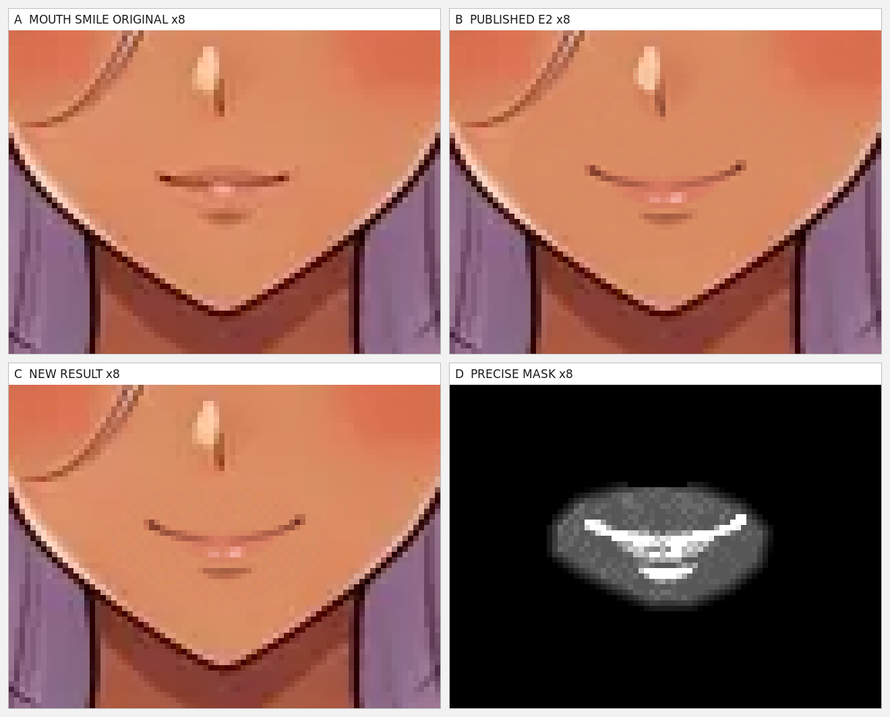
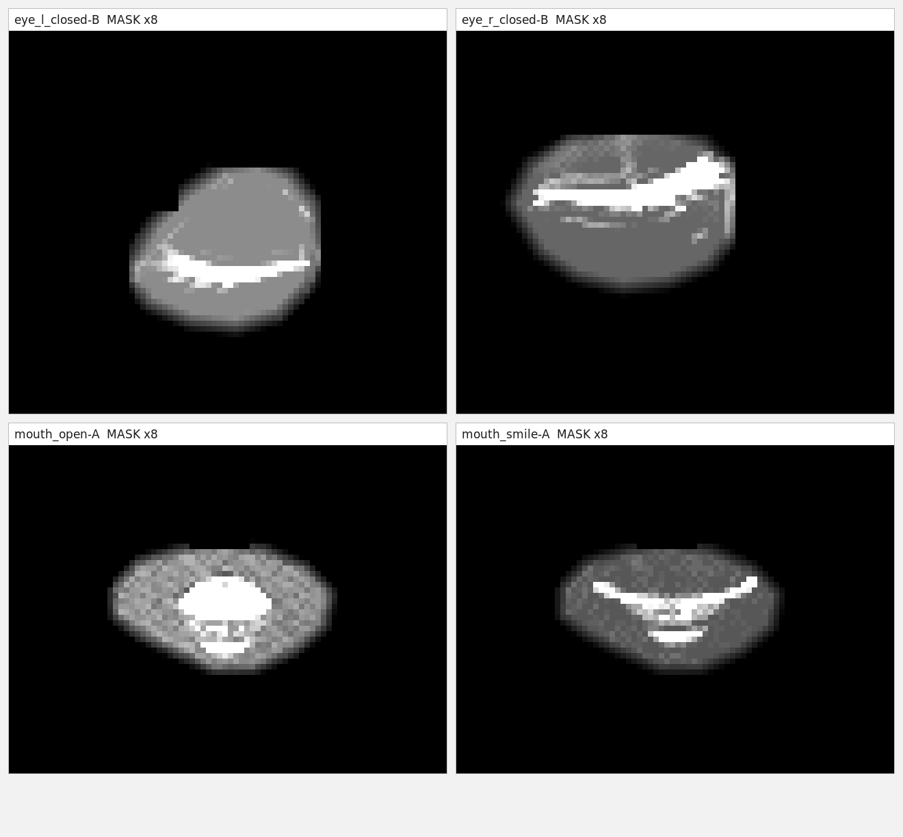

# E2 / FULL FACE BASE — визуальная проверка (iPhone)

Один экран = одна картинка; каждая открывается в полном размере по нажатию.
Все листы шириной не более ~1300 px и масштабируются под ширину телефона.

## Главное

## Участки ×8

## Четыре точные маски

## Отдельные панели (удобно зумить)

- [02-left-eye-a](comparison/panels/02-left-eye-a.png)
- [02-left-eye-b](comparison/panels/02-left-eye-b.png)
- [02-left-eye-c](comparison/panels/02-left-eye-c.png)
- [02-left-eye-d](comparison/panels/02-left-eye-d.png)
- [03-right-eye-a](comparison/panels/03-right-eye-a.png)
- [03-right-eye-b](comparison/panels/03-right-eye-b.png)
- [03-right-eye-c](comparison/panels/03-right-eye-c.png)
- [03-right-eye-d](comparison/panels/03-right-eye-d.png)
- [04-mouth-open-a](comparison/panels/04-mouth-open-a.png)
- [04-mouth-open-b](comparison/panels/04-mouth-open-b.png)
- [04-mouth-open-c](comparison/panels/04-mouth-open-c.png)
- [04-mouth-open-d](comparison/panels/04-mouth-open-d.png)
- [05-mouth-smile-a](comparison/panels/05-mouth-smile-a.png)
- [05-mouth-smile-b](comparison/panels/05-mouth-smile-b.png)
- [05-mouth-smile-c](comparison/panels/05-mouth-smile-c.png)
- [05-mouth-smile-d](comparison/panels/05-mouth-smile-d.png)
- [face-00-neutral-2x](comparison/panels/face-00-neutral-2x.png)
- [face-01-eye_l_closed-B-2x](comparison/panels/face-01-eye_l_closed-B-2x.png)
- [face-02-eye_r_closed-B-2x](comparison/panels/face-02-eye_r_closed-B-2x.png)
- [face-03-mouth_open-A-2x](comparison/panels/face-03-mouth_open-A-2x.png)
- [face-04-mouth_smile-A-2x](comparison/panels/face-04-mouth_smile-A-2x.png)
- [face-05-both-eyes-closed-2x](comparison/panels/face-05-both-eyes-closed-2x.png)
- [face-06-both-eyes-closed-smile-2x](comparison/panels/face-06-both-eyes-closed-smile-2x.png)
- [face-07-mouth_open-both-eyes-closed-2x](comparison/panels/face-07-mouth_open-both-eyes-closed-2x.png)
- [face-08-eye_l_closed-smile-2x](comparison/panels/face-08-eye_l_closed-smile-2x.png)
- [face-09-eye_r_closed-mouth_open-2x](comparison/panels/face-09-eye_r_closed-mouth_open-2x.png)
- [face-full-base-2x](comparison/panels/face-full-base-2x.png)
- [face-original-2x](comparison/panels/face-original-2x.png)
- [full-original-50](comparison/panels/full-original-50.png)
- [full-result-50](comparison/panels/full-result-50.png)
- [mask-eye_l_closed-B-8x](comparison/panels/mask-eye_l_closed-B-8x.png)
- [mask-eye_r_closed-B-8x](comparison/panels/mask-eye_r_closed-B-8x.png)
- [mask-mouth_open-A-8x](comparison/panels/mask-mouth_open-A-8x.png)
- [mask-mouth_smile-A-8x](comparison/panels/mask-mouth_smile-A-8x.png)

## Документы

- [Технический отчёт](E2-FACE-BASE-FULL-REPORT.md)
- [Автоматическая проверка (JSON)](verify-report.json)
- [Машиночитаемые метрики](E2-face-base-full.json)
- [Матрица переключения](states/switch-matrix.json)
- [SHA256-манифест](SHA256-MANIFEST.txt) · [JSON](SHA256-MANIFEST.json)
- [Блок A](blocks/A-right-eye/block-A-report.json) · [Блок B](blocks/B-mouth/block-B-report.json)

Генеративный ИИ, inpainting и generative fill не применялись.
