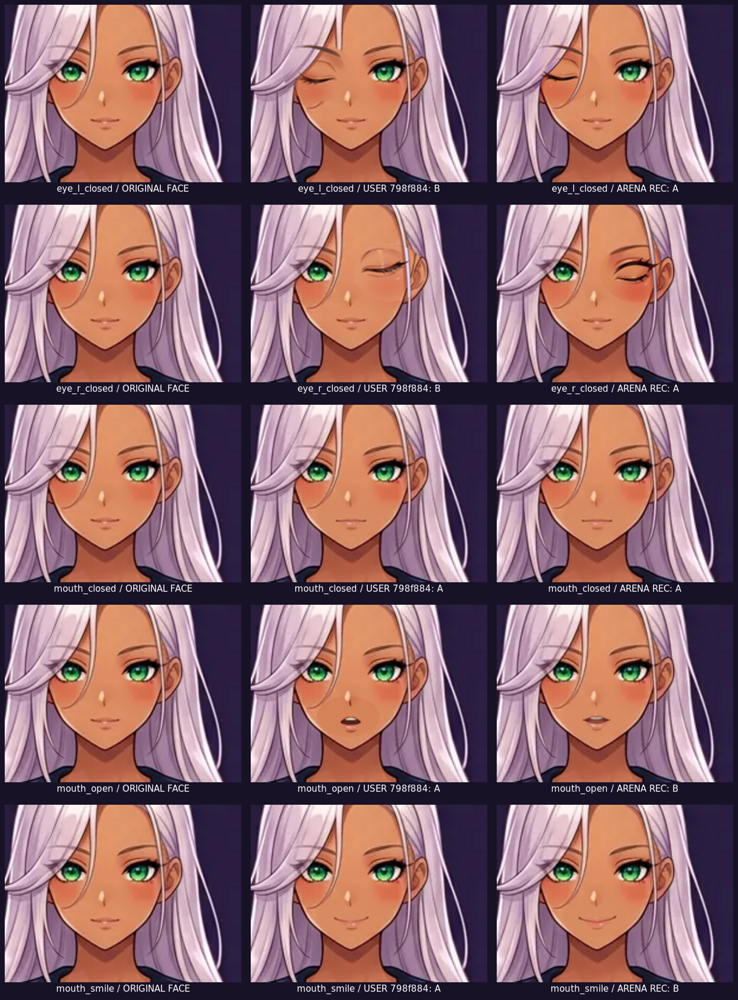
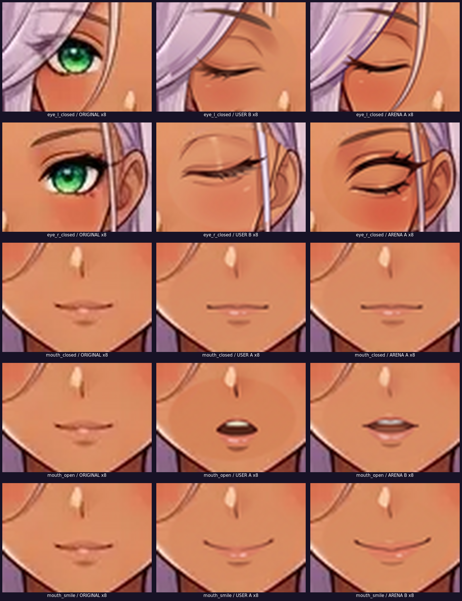
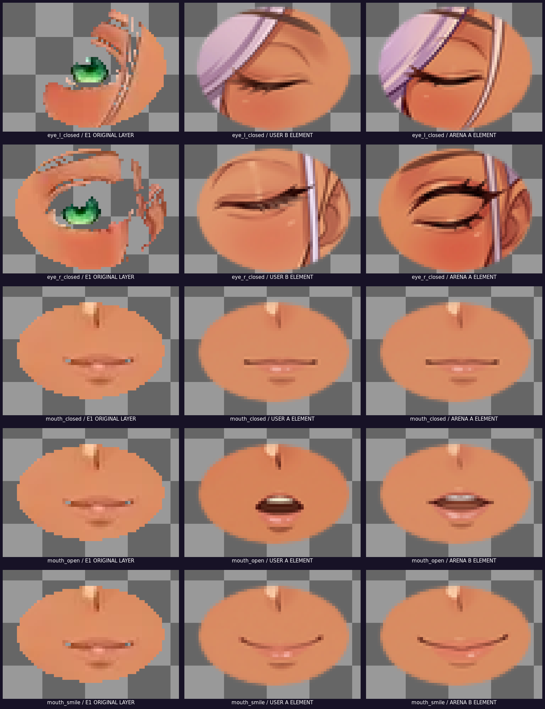
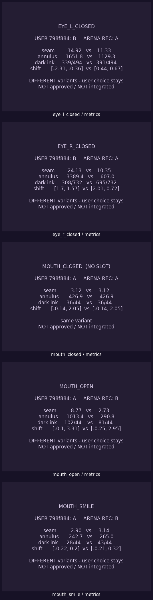
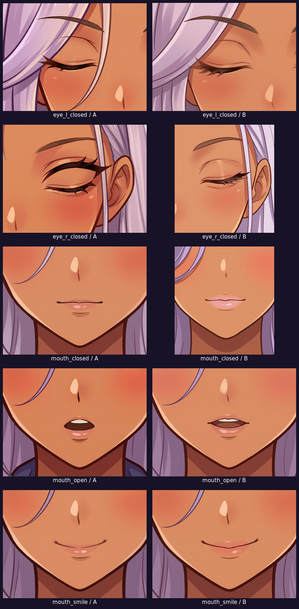

# E2 · Отдельный набор для рассмотрения

**Статус:** только для просмотра. Не опубликовано (нет commit/push по явному запрету).
Действует выбор из коммита `798f884`; рекомендации Arena не утверждены и не отменяют его.

Отчёт о проверке HEAD и сравнении: [E2-REVIEW-REPORT.md](E2-REVIEW-REPORT.md).

---

## 1. Сравнительный просмотр (с оригинальным лицом рядом)

Три столбца в каждом листе: **ORIGINAL FACE / USER 798f884 / ARENA REC**.

[открыть отдельно](comparison/E2-choice-vs-recommendation.png)

**Увеличение ×8 — линии, ресницы, форма глаз, губы, выражение:**

[открыть отдельно](comparison/E2-choice-vs-recommendation-ZOOM.png)

**Изолированные RGBA-элементы на шахматке:**

[открыть отдельно](comparison/E2-choice-vs-recommendation-ELEMENTS.png)

**Метрики по каждому состоянию:**

[открыть отдельно](comparison/E2-choice-vs-recommendation-METRICS.png)

---

## 2. Таблица расхождений

| Состояние | USER `798f884` | ARENA REC | Шов (U/A) | Annulus (U/A) |
|---|---|---|---:|---:|
| `eye_l_closed` | B | A | 14.92 / 11.33 | 1651.8 / 1129.3 |
| `eye_r_closed` | B | A | 24.13 / 10.35 | 3389.4 / 607.0 |
| `mouth_closed` | A (ориентир, без слота) | A (ориентир, без слота) | 3.12 / 3.12 | 426.9 / 426.9 |
| `mouth_open` | A | B | 8.77 / 2.73 | 1013.4 / 290.8 |
| `mouth_smile` | A | B | 2.90 / 3.14 | 242.7 / 265.0 |

Машиночитаемая версия: [metrics/E2-choice-vs-recommendation.json](metrics/E2-choice-vs-recommendation.json).

---

## 3. Все 10 кандидатов без обработки

[открыть отдельно](previews/E2-raw-candidates.png) ·
[все 10 файлов](all-10-candidates/)

---

## 4. Прочие материалы

- [E2-FINAL-CONTACT.png](previews/E2-FINAL-CONTACT.png) — исходный итоговый контактный лист.
- [E2-ENLARGED-SMOOTH.png](previews/E2-ENLARGED-SMOOTH.png) — ×8 сглаженное по всем A/B.
- [E2-ENLARGED-ON-FACE.png](previews/E2-ENLARGED-ON-FACE.png) — ×8 пиксельно-точное.
- [E2-ENLARGED-ELEMENTS.png](previews/E2-ENLARGED-ELEMENTS.png) — изолированные A/B.
- [E2-mouth-closed-vs-neutral.png](previews/E2-mouth-closed-vs-neutral.png) — нужен ли отдельный слот.
- [E2-overview.png](previews/E2-overview.png), [E2-pilots.png](previews/E2-pilots.png) — обзор и технические пилоты.
- Пять листов `previews/E2-compare-<состояние>.png` и 20 одиночных превью.
- Принятые отчёты (копии): [reports/](reports/).
- Метрики: [metrics/](metrics/) · `E2-alignment.json`, `E2-alignment-check.json`, `E2-final-metrics.json`.
- Воспроизводимый скрипт листов: [build_comparison.py](build_comparison.py).

---

## 5. Чего здесь нет

Нет второго набора AI-кандидатов: в репозитории существует ровно один набор из 10 A/B
(опубликован в `7f74ade`) плюс 3 технических пилота. Нет интеграции в риг, новых слотов,
правок базы лица, скрытых зон, ручной дорисовки, изменений `PLAN.md`, оригиналов, E1,
кода, атласа, PR #3 и Production. `E2-DECISION.md` и `E2-decision.json` не менялись.

После подготовки — остановка. Ждём отдельного разрешения.
