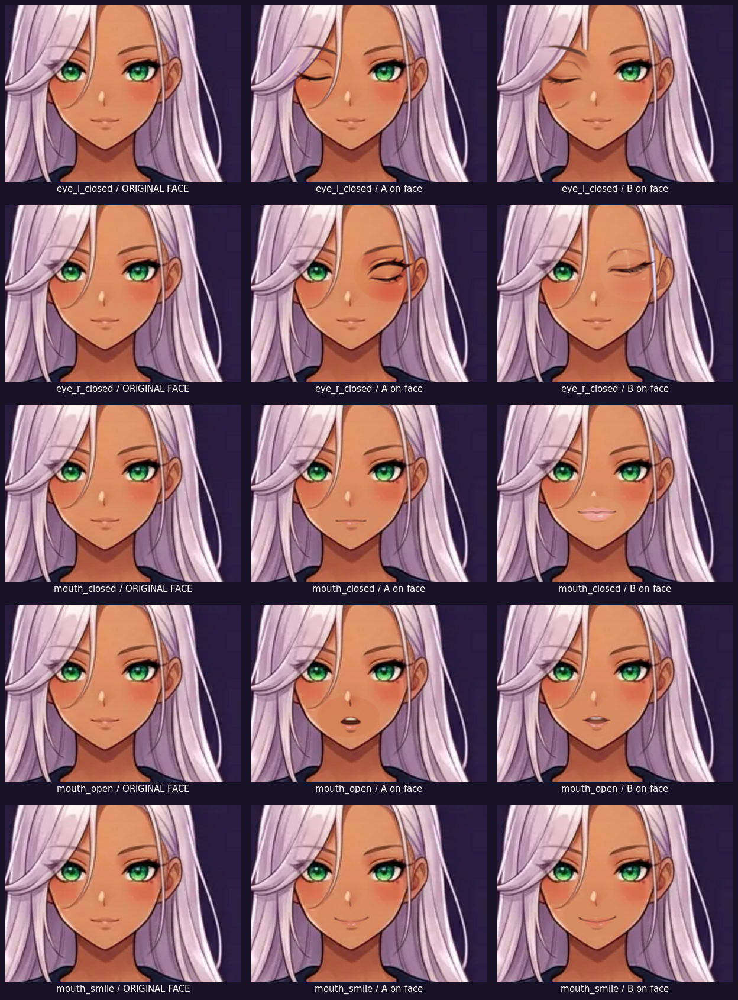
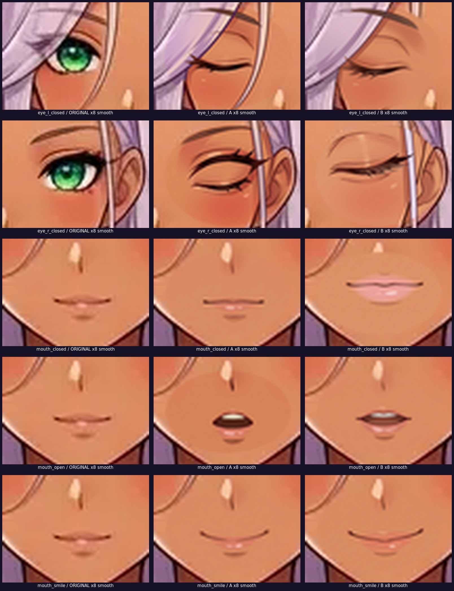
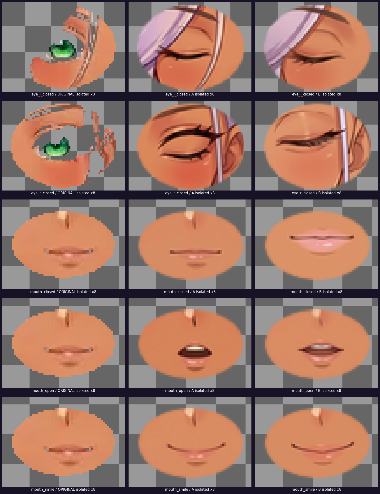
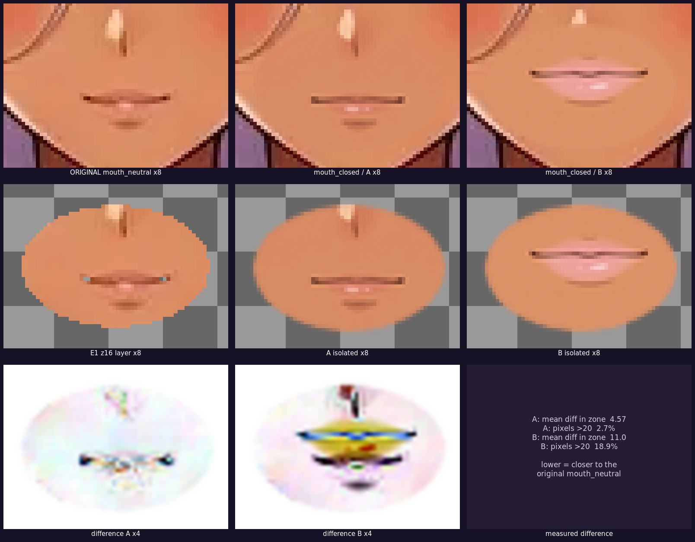
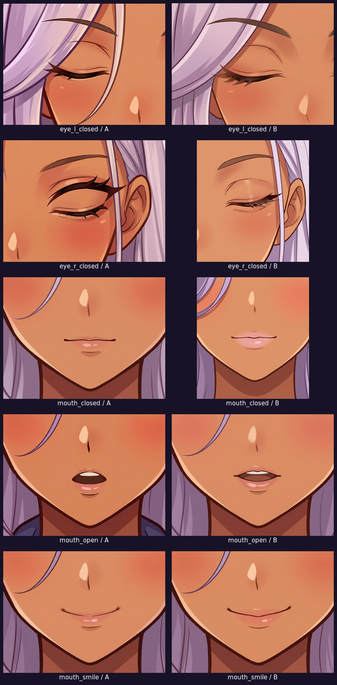
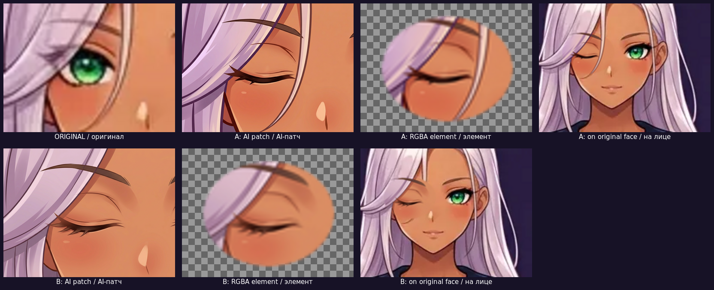
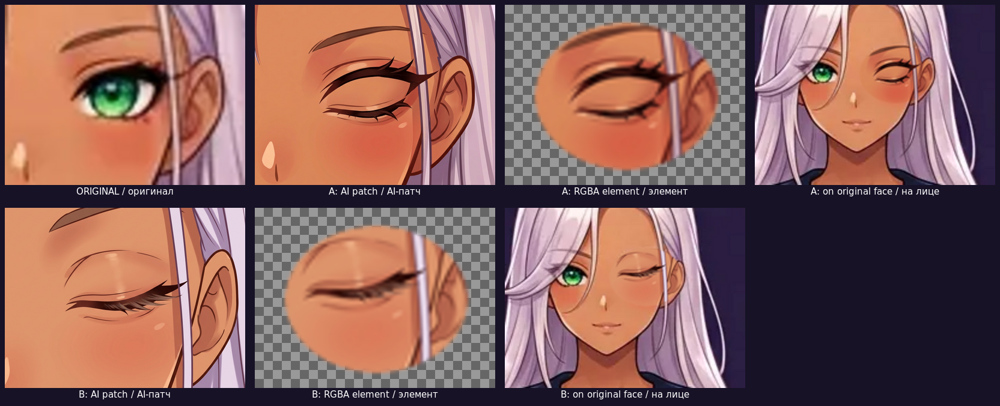
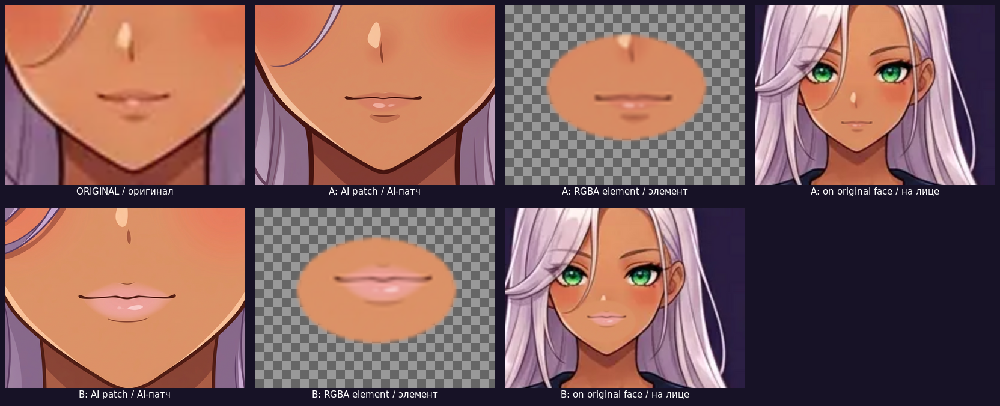
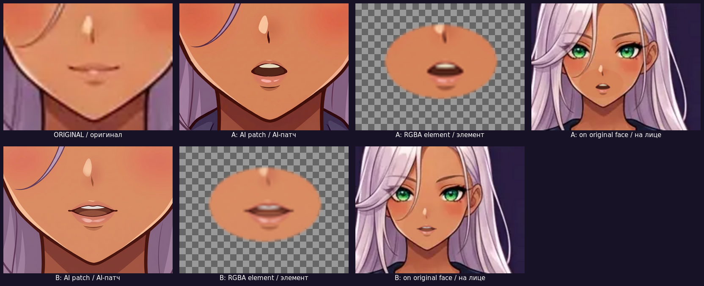
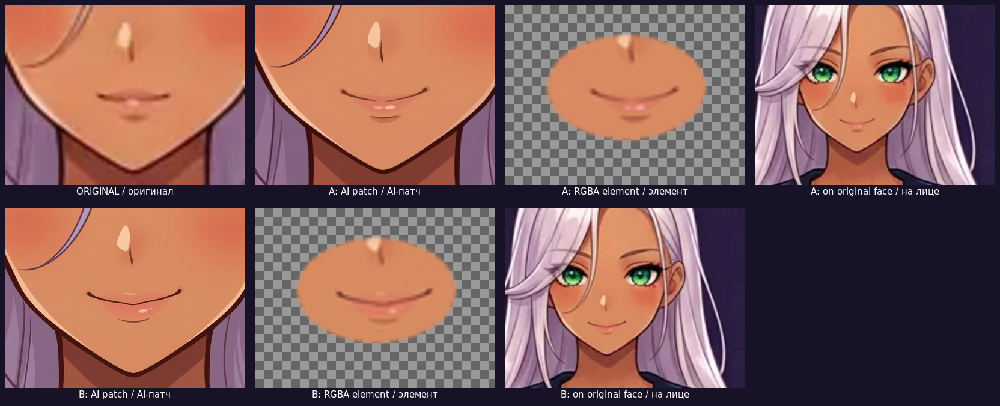

# E2 · Галерея для просмотра (iPhone в том числе)

**Статус: КАНДИДАТЫ НЕ УТВЕРЖДЕНЫ.** Эта папка опубликована **только для просмотра**.
Ни один вариант A/B не принят, интегрировать элементы в риг, менять базу лица
и переходить к следующим этапам запрещено до отдельного решения.

Ветка: `arena/02869c32-actual-new-clicker` · Папка: `art-studio/stages/05-independent-layers/E2-facial-states/`

Прямая ссылка на любую картинку из этой папки имеет вид:

```
https://raw.githubusercontent.com/trappedg1-hub/Actual-new-clicker-/arena/02869c32-actual-new-clicker/art-studio/stages/05-independent-layers/E2-facial-states/<путь к файлу>
```

Например `previews/E2-FINAL-CONTACT.png`. Ссылки открываются напрямую в Safari на iPhone.
Альтернатива: `https://github.com/trappedg1-hub/Actual-new-clicker-/blob/arena/02869c32-actual-new-clicker/art-studio/stages/05-independent-layers/E2-facial-states/<путь>?raw=1`

---

## 1. Главный контактный лист

Все 5 состояний: **оригинальное лицо / вариант A на лице / вариант B на лице**.



[Открыть картинку отдельно](previews/E2-FINAL-CONTACT.png)

---

## 2. Увеличение ×8 — проверка линий, ресниц, глаз, губ, выражения

Три вида увеличения: пиксельно-точное, сглаженное (для оценки манеры) и изолированные
RGBA-элементы на шахматке. В каждом листе 5 строк состояний × 3 столбца
(оригинал / A / B).

**Пиксельно-точное (`Point`, видны реальные пиксели и края):**


[Открыть отдельно](previews/E2-ENLARGED-ON-FACE.png)

**Сглаженное (`Lanczos`, удобно судить о толщине обводки и стиле):**



[Открыть отдельно](previews/E2-ENLARGED-SMOOTH.png)

**Изолированные элементы на шахматке (прозрачность, форма следа):**



[Открыть отдельно](previews/E2-ENLARGED-ELEMENTS.png)

---

## 3. `mouth_closed` против оригинального `mouth_neutral`

Вопрос, нужен ли пятый отдельный слот. Три строки: на лице / изолированные слои /
карта разницы ×4 с численными метриками.



[Открыть отдельно](previews/E2-mouth-closed-vs-neutral.png)

---

## 4. Все 10 AI-патчей без обработки



[Открыть отдельно](previews/E2-raw-candidates.png)

---

## 5. По каждому состоянию: оригинал / AI-патч / RGBA / на лице

| Состояние | Лист сравнения |
|---|---|
| `eye_l_closed` | [открыть](previews/E2-compare-eye_l_closed.png) |
| `eye_r_closed` | [открыть](previews/E2-compare-eye_r_closed.png) |
| `mouth_closed` | [открыть](previews/E2-compare-mouth_closed.png) |
| `mouth_open` | [открыть](previews/E2-compare-mouth_open.png) |
| `mouth_smile` | [открыть](previews/E2-compare-mouth_smile.png) |











---

## 6. Дополнительные листы

- [E2-overview.png](previews/E2-overview.png) — обзор A/B на лице (первый вариант раскладки).
- [E2-pilots.png](previews/E2-pilots.png) — 3 технических пилота, **не кандидаты**.

---

## 7. Отдельные крупные превью (10 элементов × 2 вида)

Для каждого `<состояние>-<A|B>` есть пара файлов 800×600:
`<…>-on-face.png` (элемент на оригинальном лице) и `<…>-element.png`
(изолированный элемент на шахматке).

| Состояние | A на лице | A изолированно | B на лице | B изолированно |
|---|---|---|---|---|
| `eye_l_closed` | [png](previews/eye_l_closed-A-on-face.png) | [png](previews/eye_l_closed-A-element.png) | [png](previews/eye_l_closed-B-on-face.png) | [png](previews/eye_l_closed-B-element.png) |
| `eye_r_closed` | [png](previews/eye_r_closed-A-on-face.png) | [png](previews/eye_r_closed-A-element.png) | [png](previews/eye_r_closed-B-on-face.png) | [png](previews/eye_r_closed-B-element.png) |
| `mouth_closed` | [png](previews/mouth_closed-A-on-face.png) | [png](previews/mouth_closed-A-element.png) | [png](previews/mouth_closed-B-on-face.png) | [png](previews/mouth_closed-B-element.png) |
| `mouth_open` | [png](previews/mouth_open-A-on-face.png) | [png](previews/mouth_open-A-element.png) | [png](previews/mouth_open-B-on-face.png) | [png](previews/mouth_open-B-element.png) |
| `mouth_smile` | [png](previews/mouth_smile-A-on-face.png) | [png](previews/mouth_smile-A-element.png) | [png](previews/mouth_smile-B-on-face.png) | [png](previews/mouth_smile-B-element.png) |

---

## 8. Исходники, метрики, отчёты

| Что | Где |
|---|---|
| 10 AI-кандидатов | `candidates/` |
| 3 технических пилота | `candidates/pilot-*.png` |
| 10 изолированных RGBA-элементов (848×1264) | `elements/` |
| 10 технических кропов-референсов из существующих пикселей | `references/` |
| Метрики | `E2-alignment.json`, `E2-alignment-check.json`, `E2-final-metrics.json` |
| Принятый технический отчёт (не менялся) | `E2-FACIAL-CANDIDATES.md` |
| Итоговый обзор, рекомендации и дефекты | `E2-CANDIDATE-REVIEW.md` |
| Воспроизводимые скрипты | `build_elements.py`, `build_previews.py`, `check_alignment.py`, `build_final_sheets.py` |

---

## 9. Что здесь НЕ сделано

Не утверждён ни один вариант. Элементы **не** интегрированы в риг, не внесены в
`layer-map.json`, в `public/` или в игру. База лица (`head` z13) не менялась, скрытые зоны
не дорисовывались, код/atlas/PR #3/Production не трогались. Оригиналы WebP, все 20 слоёв E1,
`PLAN.md`, `E1-REPORT.md` и контрольная версия `f13ed9e` остались байт-в-байт прежними.

После публикации — остановка. Ждём отдельного решения по каждому из пяти состояний.
